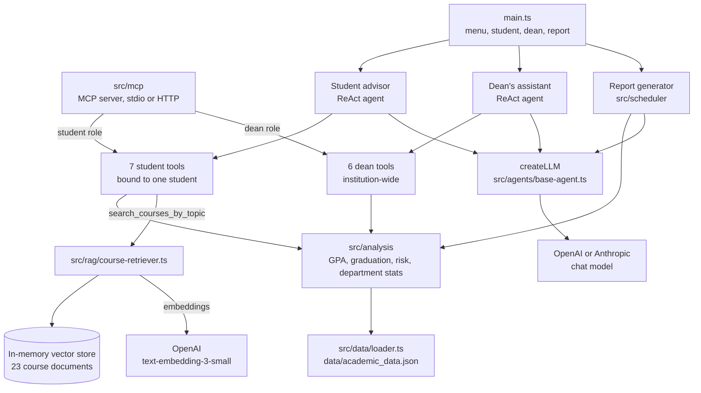

# Academic Agent

[](https://github.com/ataege/academic-agent/actions/workflows/ci.yml)

Academic Agent is a terminal AI assistant for a fictional university, built with
TypeScript on Deno, LangChain and LangGraph. Two ReAct agents answer questions
over synthetic academic records: a student advisor scoped to one student, and a
dean's assistant with an institution-wide view. Between them they use 13 tools
that do their calculations in ordinary, unit-tested TypeScript and return
structured JSON, so the model explains results instead of computing them. A RAG
tool adds semantic course search, a report mode writes three Markdown reports,
and chat runs on OpenAI or Anthropic, chosen by an environment variable. An
[MCP server](#mcp-server) exposes the same tools, plus resources and prompts, to
any MCP client such as Claude Desktop or Claude Code.

## Architecture



`createLLM` is the only place a chat provider is chosen. Embeddings always use
OpenAI, whichever chat provider is selected.

```
main.ts                CLI, menu and chat loop
src/agents/            createLLM and the two agents with their system prompts
src/tools/             13 LangChain tools: 7 for students, 6 for the dean
src/analysis/          GPA, graduation, risk and department calculations
src/rag/               Course embeddings and semantic search
src/scheduler/         Report prompts and generation
src/data/loader.ts     Loading and lookups for the JSON data
src/mcp/               MCP server: tools, resources, prompts and transports
data/                  Synthetic data: 6 students, 23 courses, 2 departments
tests/                 Unit tests, run without an API key or network access
```

## Setup

1. Install
   [Deno 2](https://docs.deno.com/runtime/getting_started/installation/). CI
   runs on 2.9.7.
2. Clone the repository:

   ```sh
   git clone https://github.com/ataege/academic-agent.git
   cd academic-agent
   ```

3. Create your local settings and add the key for the provider you want:

   ```sh
   cp .env.example .env
   ```

| Variable            | Default                       | Purpose                                                    |
| ------------------- | ----------------------------- | ---------------------------------------------------------- |
| `LLM_PROVIDER`      | `openai`                      | Chat provider: `openai` or `anthropic`                     |
| `LLM_MODEL`         | `gpt-4o` or `claude-opus-5-5` | Overrides the selected provider's default model            |
| `OPENAI_API_KEY`    | none                          | Chat with `openai`, and course search with either provider |
| `ANTHROPIC_API_KEY` | none                          | Chat with `anthropic`                                      |

With `LLM_PROVIDER=anthropic` and no `OPENAI_API_KEY`, the agents still work,
but course search doesn't: `search_courses_by_topic` returns an error to the
model.

## Usage

Inside a chat, type `help` for example questions and `exit` to leave.

The sample answers below were written by hand from the real output of each tool
on the sample data. The facts and numbers are exact, but the wording of a live
model response will differ.

### Menu mode

```sh
deno task dev
```

The menu leads to the other three modes. Choosing Student Mode and then Emily
Johnson:

> **You:** What courses should I take next semester?
>
> **Advisor:** You're in good standing, with 72 of 140 credits and an estimated
> graduation of Spring 2026. You meet the prerequisites for two electives you
> haven't taken: Web Development (CENG 360) and Mobile Application Development
> (CENG 370), at 3 credits each. You still need 15 elective credits, and your
> remaining required courses are Database Systems, Operating Systems, Computer
> Networks and the Senior Project.

### Student mode

```sh
deno task student --student=STU005
```

`--student` takes an ID or part of a name. Without it, the command opens the
menu.

> **You:** Which courses am I at risk of failing?
>
> **Advisor:** Two courses need attention this semester: Calculus II, where your
> midterm was 52, and Discrete Mathematics, where it was 55. To pass with a CC,
> you'd need 82% on the Calculus II final and 80% on the Discrete Mathematics
> final. Both are achievable, and tutoring and academic support services are
> worth considering.

### Dean mode

```sh
deno task dean
```

> **You:** Show all at-risk students
>
> **Advisor:** The data shows 2 of 6 students at risk, both in Computer
> Engineering. David Wilson (STU003, GPA 1.75) is critical: on probation, with a
> failing midterm of 48% in MATH 201, an at-risk midterm of 55% in MATH 202, and
> low attendance in both. James Taylor (STU005, GPA 1.95) is at warning level,
> with at-risk midterms in MATH 102 and MATH 202. Software Engineering has no
> at-risk students.

### Report mode

```sh
deno task report
```

This mode doesn't take typed questions. Each report has a built-in prompt, and
the three are written to `reports/YYYY-MM-DD/`: `at-risk-students.md`,
`department-summary.md` and `intervention-plan.md`. On the sample data, the
intervention plan would answer the question below along these lines:

> **Question:** Who needs intervention first?
>
> **High priority (this week):** David Wilson (STU003, GPA 1.75, on probation)
> must maintain a 2.0 GPA this semester to avoid dismissal, and needs immediate
> help with Linear Algebra.
>
> **Course-level:** Calculus II has the highest fail rate at 28.6%, followed by
> Object-Oriented Programming at 20.0%.

## MCP server

The MCP server starts in one role and registers only that role's tools. In the
student role it is pinned to one student ID at startup, and no student tool
takes an ID, so a client can't reach another student's records. Every tool is
read-only. It needs no API key, except `search_courses_by_topic`, which uses
OpenAI embeddings.

```sh
deno task mcp --role=student --student=STU001
deno task mcp --role=dean
```

### Connect a client

Claude Code, from the repository directory:

```sh
claude mcp add academic -- deno task mcp --role=student --student=STU001
```

Claude Desktop, in `claude_desktop_config.json`, with the absolute path to your
clone:

```json
{
  "mcpServers": {
    "academic-student": {
      "command": "deno",
      "args": [
        "run",
        "--allow-read",
        "--allow-env",
        "--allow-net",
        "/absolute/path/to/academic-agent/src/mcp/main.ts",
        "--role=student",
        "--student=STU001"
      ]
    }
  }
}
```

The server finds its data and `.env` relative to its own file, so clients can
launch it from any directory.

To browse everything interactively, use the
[MCP Inspector](https://github.com/modelcontextprotocol/inspector):

```sh
npx @modelcontextprotocol/inspector deno task mcp --role=dean
```

### What it exposes

| Kind      | Student role                                                                  | Dean role                                       |
| --------- | ----------------------------------------------------------------------------- | ----------------------------------------------- |
| Tools     | The 7 student tools, bound to one student                                     | The 6 dean tools                                |
| Resources | `academic://courses`, `academic://courses/{code}`, `academic://grading-scale` | The same, plus `academic://students/{id}`       |
| Prompts   | `advising-session`                                                            | `at-risk-review`, with an optional `department` |

Tools keep the names and descriptions the agents use. Each returns
`structuredContent` matching a published `outputSchema`, plus the same JSON as
text for clients that don't read structured output. A lookup miss, such as an
unknown course code, comes back as a tool error the model can act on.

### Remote mode

Streamable HTTP is available for clients that connect by URL:

```sh
MCP_AUTH_TOKEN=$(openssl rand -hex 32) deno task mcp --role=dean --transport=http --port=3000
```

The endpoint is `http://127.0.0.1:3000/mcp`, and `/health` answers without a
token. Requests need `Authorization: Bearer <token>`. The server binds to
localhost unless `--hostname` says otherwise, rejects browser requests from
other websites by their `Origin` header, and on localhost also checks the `Host`
header against DNS rebinding. It is stateless, so each request gets a fresh
server.

### MCP design notes

- **Role scoping:** a role decides which tools exist, rather than a check inside
  each tool, so the model can't call what isn't registered.
- **Thin layer:** `src/mcp` wraps the existing LangChain tools, so the agents
  and MCP clients get the same results from the same code.
- **Strict output schemas:** they list every field, and the tests parse every
  tool's output against them, so a changed tool can't silently drift from its
  schema.
- **Data is data:** tool results go back to a model, and free text in the data,
  such as advisor notes and course descriptions, could carry prompt-injection
  text. Results are structured fields, the tools are read-only, and each role
  sees only what it needs.
- **stdio and HTTP:** stdio is the default for local clients, which launch the
  server as a process. HTTP is for clients that need a URL, and uses a bearer
  token instead of full OAuth.

## Design decisions

### Why ReAct agents

Questions here need different data, and sometimes several steps. "Which courses
am I at risk of failing?" needs one tool, while "Am I on track, and what should
I take next?" needs several, chosen as earlier answers come in. A ReAct loop
lets the model pick tools and stop when it has enough, which avoids hand-written
routing for each kind of question. `createReactAgent` provides the loop, so the
project only supplies tools and a system prompt. The cost is less predictable
latency and token use than a fixed pipeline.

Separate agents also limit access. The student agent's tools are bound to one
student when they're created and take no student ID, so the model has no way to
request another student's record.

### Why tools return structured data

Grades, GPA, risk levels and graduation rules live in `src/analysis`, and tools
return their results as JSON. These numbers drive advice to students, and a
model can't be relied on for arithmetic or for applying rules consistently.
Keeping the logic in code makes results repeatable, lets the rules be tested
without an API key, and means a fix reaches every agent and report at once. The
model's job is to choose tools and explain what they return. Nothing checks its
final wording, so it can still misreport a result.

### Why an in-memory vector store

The catalogue has 23 short course descriptions. Comparing a query against that
few documents needs no index, and a vector database would add a service to run
with no benefit at this size. The trade-off is that embeddings are recomputed on
every start and lost on exit, which a persistent store would avoid for a much
larger catalogue.

## Testing

```sh
deno task test
```

Tests cover the analysis modules and the data loader using the sample data,
including no completed courses, failed and retaken courses, and missing
prerequisites. Provider selection, the tool loop and report generation run
against a fake Anthropic API inside the test process, and course search runs on
local word-count embeddings. The MCP tests connect a real MCP client to the
server in memory, and to the HTTP handler without opening a port, and check role
scoping, output schemas, resources, prompts, authentication and error handling.
The test task doesn't grant network access, so a test that tries to use it
fails.

CI runs `deno fmt --check`, `deno lint`, `deno check main.ts src/mcp/main.ts`
and `deno task test` with no secrets configured.

## Limitations

- **Synthetic data:** the 6 students and 23 courses are made up, and results
  haven't been tested on real records.
- **Stored totals don't match enrollments:** tools report the `gpa` and
  `completed_credits` stored on each student, which don't reconcile with the
  listed enrollments. STU001 has 72 stored credits but 30 from passed courses,
  and a stored GPA of 3.85 against 3.75 from `calculateGPA`.
- **Sparse catalogue:** department catalogues list fewer non-required credits
  than the 18 elective credits required (12 for CENG, none for SENG).
- **Inconsistent pass line:** the data marks grades down to FD as passed, while
  `get_at_risk_courses` treats CC as the minimum pass.
- **Simple risk rules:** attendance and midterms from 50 to 59 are listed as
  risk factors but don't raise a student's risk level.
- **No chat memory:** each question is sent on its own, so follow-up questions
  lack context. `executeQueryWithHistory` exists but isn't connected to the chat
  loop.
- **No real scheduling:** reports are generated once per run of
  `deno task report`, so daily reports need an external scheduler such as cron.
- **Repeated embedding:** the vector store is rebuilt on every start in every
  mode, including report mode, which doesn't use it.
- **Temperature is OpenAI-only:** `@langchain/anthropic` 0.3 always sends
  sampling parameters that current Claude models reject, so `createLLM` clears
  them and Claude runs with its default sampling.
- **Fixed current semester:** graduation estimates assume the current semester
  is Fall 2024.
- **No answer evaluation:** tests check the calculations and the agent wiring,
  not the quality of model answers.
- **No access control:** anyone running the CLI can open any student or the dean
  view.

- **Static MCP token:** remote mode uses one shared bearer token, not the OAuth
  flow the MCP spec describes for remote servers.

## Next steps

- Connect `executeQueryWithHistory` to the chat loop so follow-up questions
  work.
- Calculate GPA and credits from enrollments, with data that reconciles.
- Add an evaluation set for agent answers, covering tool choice and faithful
  reporting of tool output.
- Build the vector store only when a mode needs it, and save embeddings between
  runs.
- Move to LangChain 1.x, where `@langchain/anthropic` handles Claude's sampling
  rules itself.
- Run reports on a schedule, for example with `Deno.cron`.

## License

[MIT](LICENSE)
